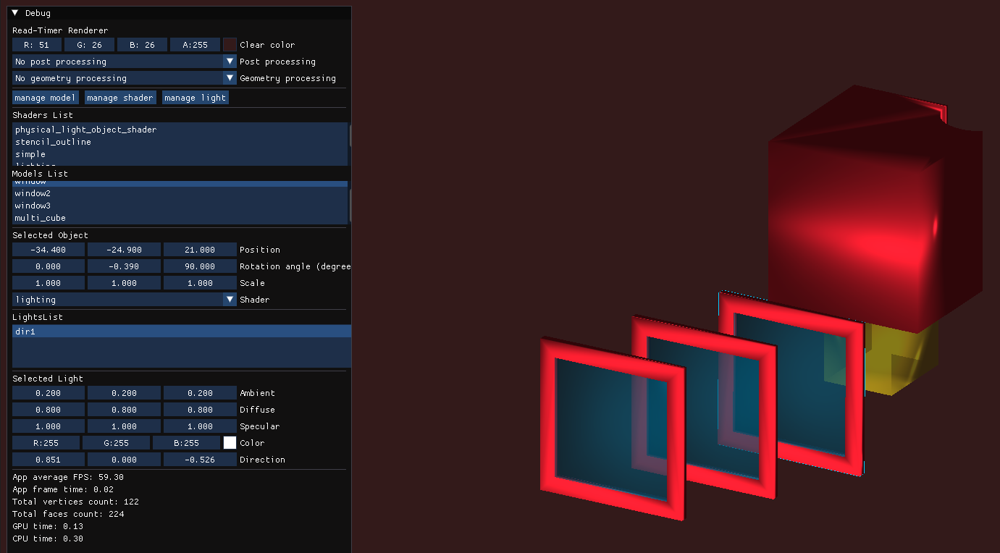
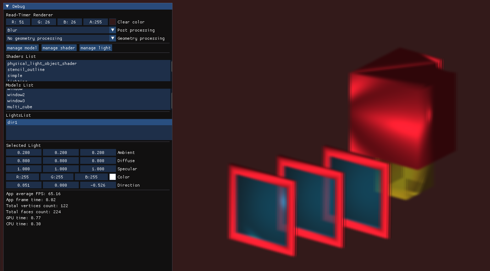
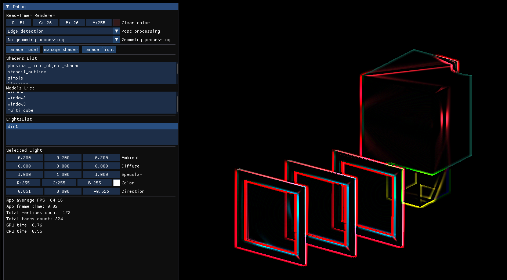
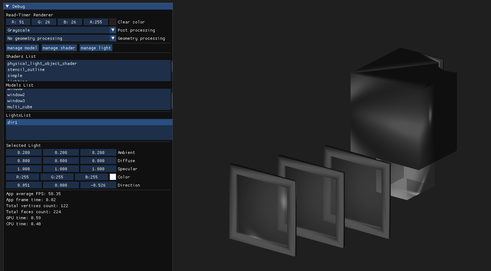
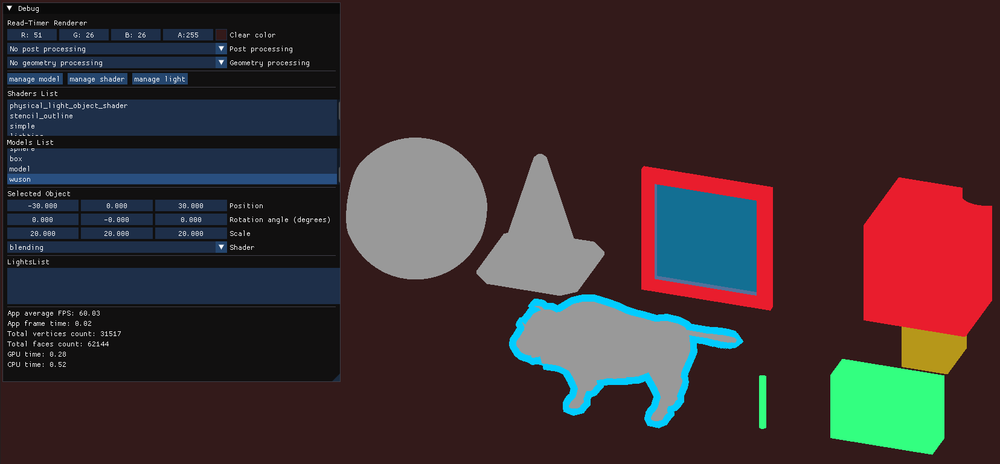
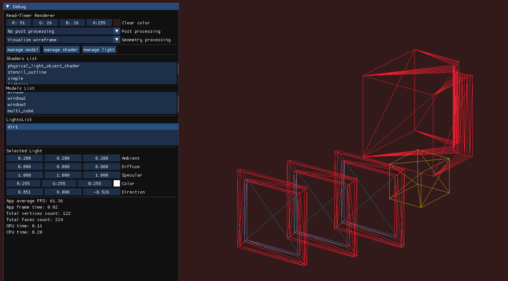
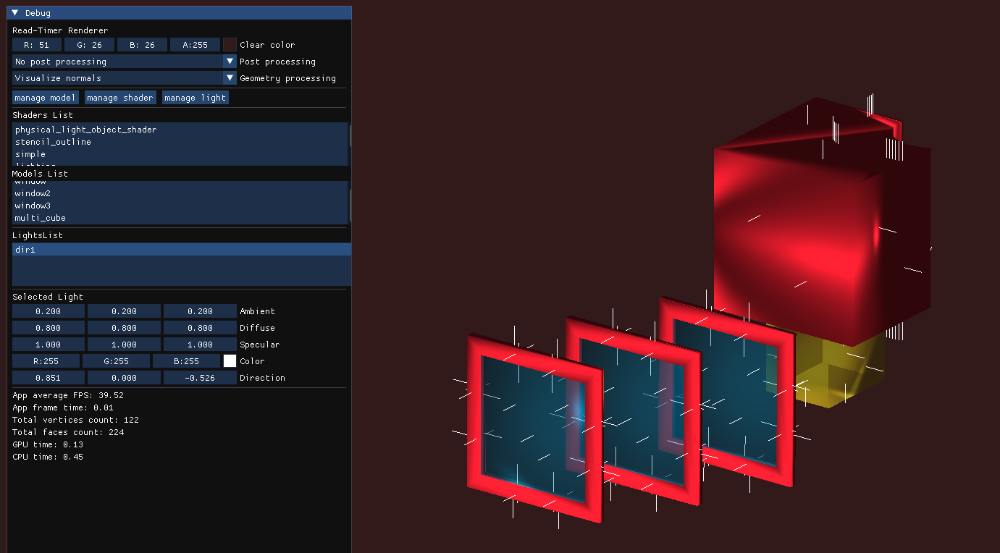
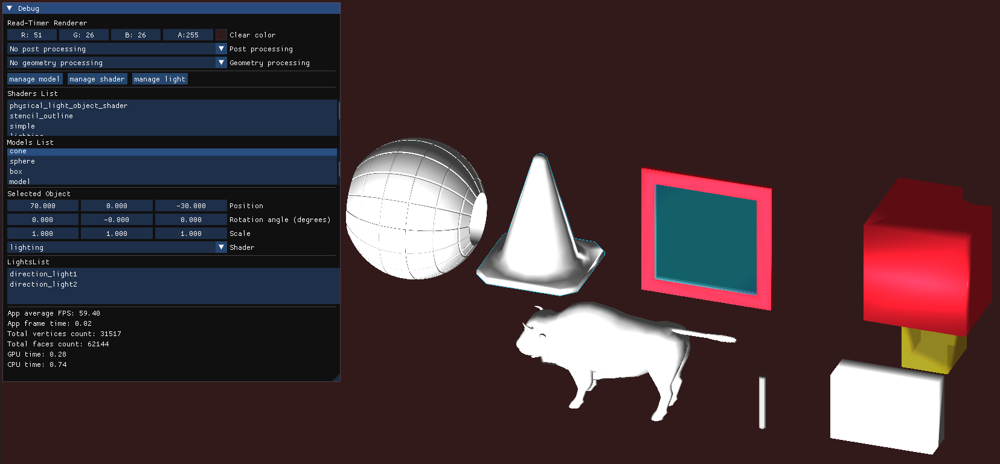
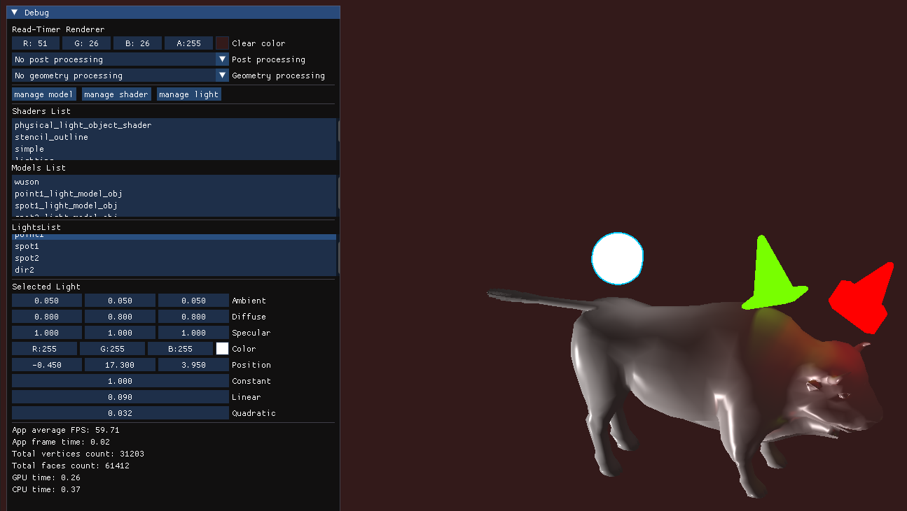
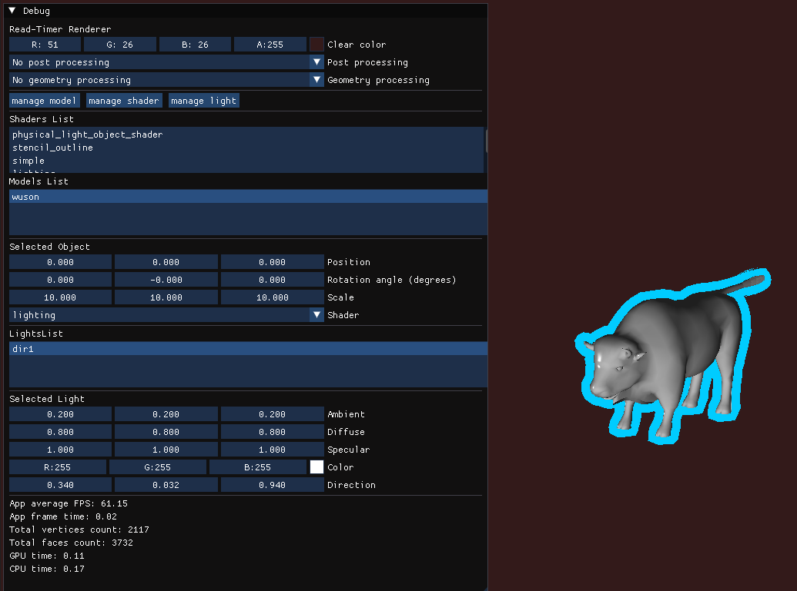

# Lightweight Real-Time OpenGL Renderer & Scene Editor

A custom-built, real-time 3D rendering framework and dynamic scene editor powered by Modern OpenGL. Designed as a high-performance playground for 3D graphics, this project features dynamic model loading, hot shader reloading, and a comprehensive user interface for real-time scene manipulation and performance profiling.

## Key Features
### Dynamic Scene Management
- **Asset Loading**: Dynamically load meshes and textures at runtime. Supports standard formats including .obj, .stl, and .glTF (with full support for both external and embedded textures).

- **Real-Time Manipulation**: Add or remove meshes on the fly. Transform objects effortlessly with dynamic scaling, rotation, and translation controls.

- **Scene Hierarchy**: Inspect and manage the scene structure through an intuitive, integrated object hierarchy tree.

### Advanced Camera System
- **Dual Movement Modes**: Switch seamlessly between Orbit (focusing on a specific target) and Free (first-person style flight) camera behaviors.

- **Flexible Projection**: Supports both Orthographic and Perspective projection modes to suit different rendering needs.

### Rendering & Materials
- **Hot Shader Reloading**: Modify, compile, and apply shaders at runtime without restarting the application.

- **Dynamic Shader Assignment**: Load a mesh with a generic shader and dynamically assign custom, specialized shaders to individual objects directly from the UI.

### Real-Time Profiling & UI
Fully wrapped and controlled using Dear ImGui, featuring a detailed render statistics dashboard:

- **Performance Metrics**: Track FPS, Frame Time, CPU Time, and GPU Time.

- **Geometry Stats**: Monitor total vertex and triangle counts in real-time.

- **Generic Controllers**: ImGui is deeply integrated not just as a wrapper, but as a library for all generic user controllers and inputs.

## Tech Stack
- **Language**: C++
- **Graphics API**: Modern OpenGL4+
- **UI Framework**: Dear ImGui
- **Asset Loading**: Assimp
- **Math**: GLM
- **Logging**: spdlog

## Build and Run

### Prerequisites

- C++20 or newer
- Installed and configured OpenGL4+
- CMake 3.14 or newer
- GCC 12 or newer

1. Clone the repository:
    ```bash
    git@github.com:GreenHatCode/real_time_renderer.git
    cd real_time_renderer
    ```
2.  Change git remote url to avoid accidental pushes to base project
    ```bash
    git remote set-url origin github_username/repo_name
    git remote -v # confirm the changes
    ```
3. Build and run (after successful build the app will start)
    ```bash
    chmod +x u_build_and_run.sh
    ./u_build_and_run.sh
    ```

## Usage examples

### Blending transparent objects with lighting


### Blur post processing


### Edge detection post processing


### Grayscale post processing


### Rendering different models


### Wireframe geometry post processing


### Drawing normals geometry post processing


### Lighting many objects


### Multiple lights


### Stencil outline

